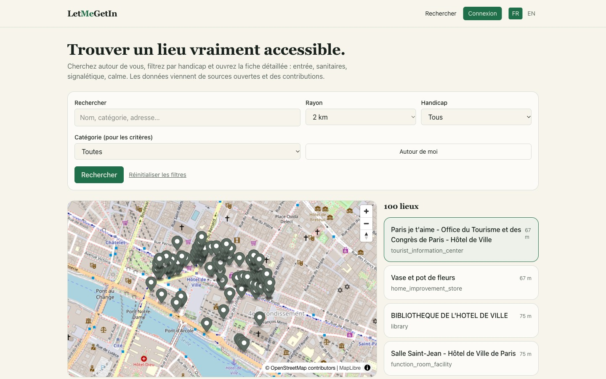
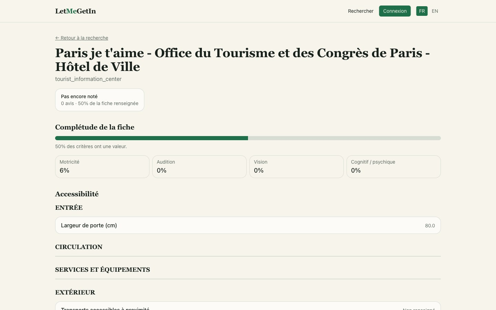
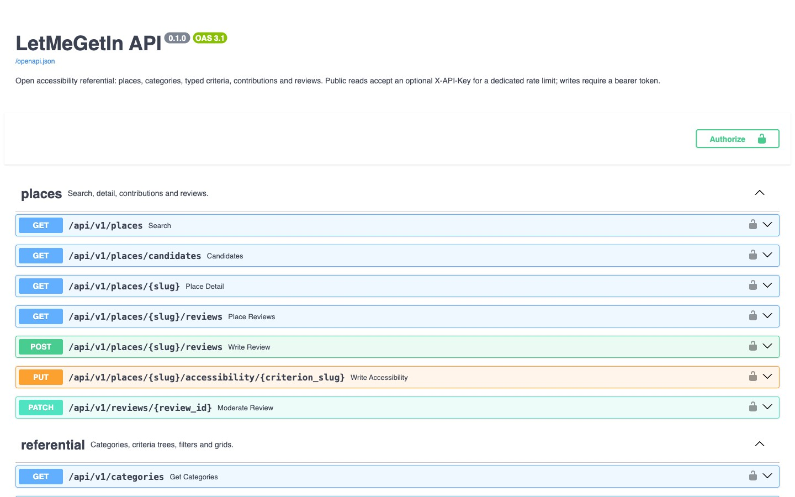

# Let Me Get In

**A normalized accessibility referential, exposed as a public API and a web app.**

[](https://app.letmegetin.org)
[](https://app.letmegetin.org)
[](https://api.letmegetin.org/docs)

[**app.letmegetin.org**](https://app.letmegetin.org) · [**api.letmegetin.org/docs**](https://api.letmegetin.org/docs) · [**source**](https://github.com/Let-Me-Get-In/letmegetin)

---

## Why

Jaccede was the historical open database of accessible places in France. When it
went away, its data went with it. A public alternative exists today and covers many
places, but an accessibility referential that is **normalized, versioned and
queryable** is still missing — the kind of thing a third party can build on, not
just browse.

Let Me Get In rebuilds that referential from the sources that survived, and exposes
it as a read-first API.

## What is in the referential

| | |
|---|---|
| Categories | 158 |
| Criteria | 182 |
| Filters | 52 |
| Official labels | 15 |

Plus the full category-1 criteria grid. Everything is committed as JSON in
`data/referential/` and loaded by a seed command. The original raw sources are
private and **not** committed; they are only needed to regenerate the JSON.

Accessibility is recorded per handicap family — motor, hearing, vision, cognitive —
and each place carries a **completeness score**, because "unknown" and "not
accessible" are not the same answer.

## Stack

| Layer | |
|---|---|
| API | FastAPI, SQLAlchemy 2 async, Pydantic v2 |
| Data | PostgreSQL + PostGIS, Redis (referential cache, rate limits) |
| Web | Next.js (App Router), TypeScript, Tailwind, MapLibre |
| Operations | OpenTofu + Ansible, one Hetzner VPS, Compose stacks, Sentry |
| Quality | 193 tests, 85% coverage floor, E2E and axe accessibility checks against a deployed environment |

## The API

Reads are open. An optional `X-API-Key` header gets you a dedicated rate limit;
writes require a bearer token.

```bash
curl "https://api.letmegetin.org/api/v1/places?lat=48.85&lng=2.35"
```

| | |
|---|---|
| Search and details | `/api/v1/places`, `/api/v1/places/{slug}` |
| Referential | `/api/v1/categories` and the criteria tree |
| Reviews and contributions | read endpoints are public, writes are authenticated |
| Contract | [`/openapi.json`](https://api.letmegetin.org/openapi.json), Swagger at `/docs` |

The admin CLI is currently the only path that writes to the referential itself.

## Repositories

| Repository | |
|---|---|
| [`letmegetin`](https://github.com/Let-Me-Get-In/letmegetin) | API, web app, referential data — public |
| `letmegetin-config` | OpenTofu + Ansible, the VPS and its Compose stacks — private |
| `letmegetin-e2e` | End-to-end and accessibility checks against a deployed environment — private |

## Status

Working, deployed, and honest about what is missing:

- **The community layer is not built.** Spots are read from the referential; the
  contribution workflow that would let visitors add and correct places is not
  there yet.
- **One host.** Development and production run as two Compose stacks on a single
  VPS, provisioned by OpenTofu and Ansible.
- **No licence yet.** The code is public, but no licence has been chosen, so
  default copyright applies. Ask before reusing it.

---

Built and maintained by [@SBillion](https://github.com/SBillion).
